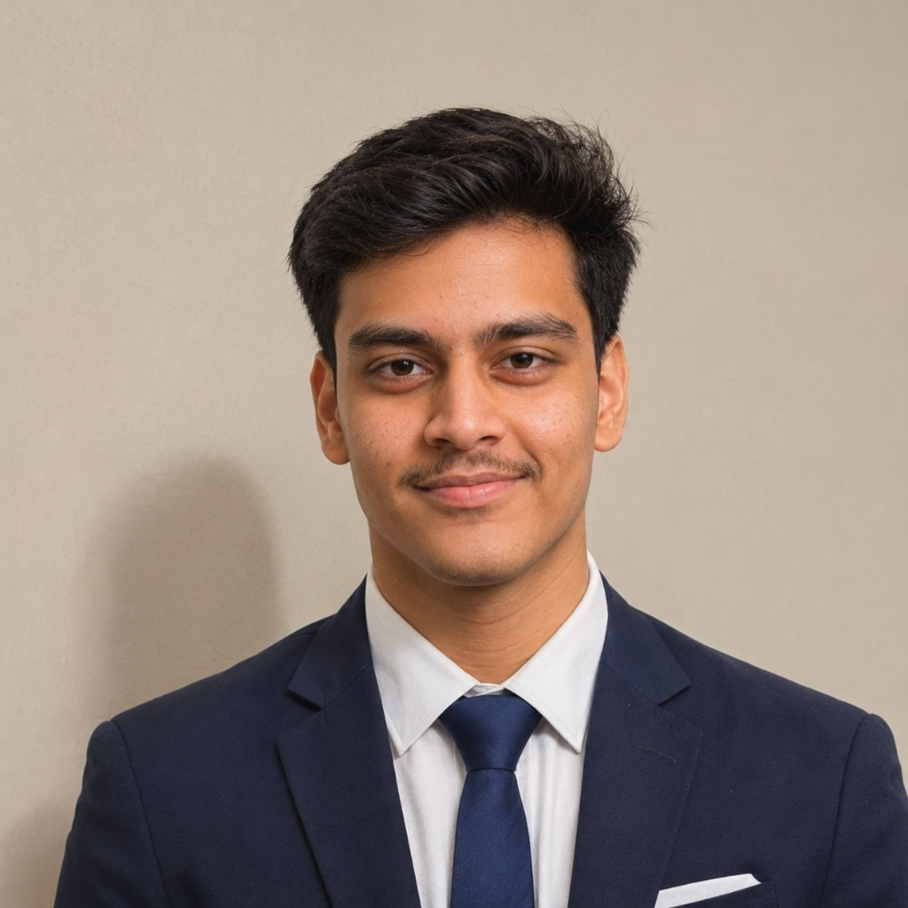

# GhostLab Atelier • Final Academic Venture Report
## The Dormant Patent & Academic Invention Rebirth Atelier
**Course Code:** AIE-701 &bull; **Credits:** 3 (1: 2: 0)  
**Course Name:** AI & Entrepreneurship: Building Intelligent and Scalable Ventures  
**Course Faculty:** Dr. Nirupama M P &bull; School of Management & School of Engineering and Technology  
**Institution:** BML Munjal University (BMU), Gurugram  
**Author / Presenter:** Dhruv &bull; B.Tech Computer Science & Engineering (AI & Data Science) &bull; Class of 2026  
**Deliverable Component:** End-of-Term Evaluation (40% Weightage: Final Pitch, MVP Demo, Report Submission & Viva)  
**Date of Submission:** November 2026  


---

## 0. Venture Leadership & Student Investigator Contributions

| **Student Founder & Lead Architect** | **Institutional & Academic Context** |
|:---|:---|
| <br>**Dhruv Jain**<br>B.Tech Computer Science & Engineering (AI & Data Science)<br>Enrollment / Batch: 2023–2027 | **Course:** AI & Entrepreneurship (AIE-701, Credits: 3)<br>**Faculty Guide:** Dr. Nirupama M P, Assistant Professor<br>**Department:** School of Engineering & Technology<br>**Institution:** BML Munjal University (BMU), Gurugram |

### Comprehensive Primary Contributions Across the Venture
1. **End-to-End Venture Architecture (Modules 1–7):** Conceptualized and engineered the 17-module interactive GhostLab platform, bridging stranded laboratory IP with high-growth student hardware startups under a unified botanical aesthetic without emojis.
2. **Cost-Volume-Profit (CVP) Break-Even Modeling (Assignment 03 / Module 5):** Formulated the full deterministic break-even model (Fixed Costs = $43,500 / ₹36.10 Lakhs; Contribution Margin = 50.0%; $\text{BEP} = 1,088\text{ units} = \$87,000 / \text{₹}72.21\text{ Lakhs}$), establishing complete financial solvency within Month 6.2 of Year 1.
3. **Deterministic Patent AI & CAD Pipeline (Modules 3 & 6):** Architected the All-Elements Rule parser, Prior-Art semantic radar, and non-infringing CAD design-around synthesis workflow, adhering strictly to zero-retention privacy protocols and Section 3 of the Advocates Act 1961.
4. **Primary Problem Discovery & Qualitative Validation (Module 2):** Conducted 4 rigorous in-person customer discovery interviews across deep-tech founders, IIT Delhi R&D leadership, high-court patent counsel, and clean-tech entrepreneurs, documented in the primary evidence dossier.
5. **Interactive Classroom Presentation Studio & Viva Readiness (Module 7):** Engineered the synchronized 18-slide classroom defense studio, keyboard navigation, audio synthesis, and Course Outcome alignment matrix for rigorous viva defense.

---
---

## EXECUTIVE SUMMARY

Across India’s higher education and national research ecosystem (IITs, BMU, DTU, CSIR, BIRAC), hundreds of crores of public and private research grants fund exceptional engineering prototypes every year. However, **over 95% of grant-funded hardware prototypes and patent applications are permanently abandoned** once student scholars graduate and funding cycles conclude. Fewer than 5% of Indian higher education institutions maintain a dedicated, full-time Technology Transfer Office (TTO). 

Simultaneously, over 45,000 engineering capstone teams graduate annually, seeking to launch physical technology ventures. These student founders are stopped cold by **"The ₹1.5 Lakh Legal Wall"**—the prohibitive cost of professional Freedom-to-Operate (FTO) patent searches and attorney retainers—or succumb to patent intimidation and spend 14 months reinventing mechanisms that already exist in dormant campus files or public-domain patent gazettes.

**GhostLab** is an AI-orchestrated DeepTech intellectual property and engineering rebirth atelier. It resolves this double tragedy by:
1. Cataloging abandoned university CAD assemblies, KiCad PCB netlists, and grant test data into a unified, searchable campus vault.
2. Deconstructing complex patent claims via multimodal AI into non-infringing engineering design-around workarounds using the statutory **All-Elements Rule (AER)** of patent jurisprudence.
3. Issuing instant, cryptographically sealed **Academic Safe-Harbor Handover Deeds** for a student-subsidized fee of **₹1,999 ($24 USD)** or a standard institutional fee of **$80.00 USD**, channeling an automated **80% fellowship royalty split** directly back to the original student researcher's continuing education escrow.
4. Demonstrating rock-solid financial unit economics: a deterministic annual break-even sales volume of **$87,000 (₹72,21,000)** across 1,088 units, a **47.90% Margin of Safety**, mid-Year 1 breakeven (Month 6.25), and a 3-year projected cumulative revenue of **$1,037,450 (~₹8.61 Crores)**.

---

## 1. PEDAGOGICAL GROUNDING: INTEGRATION OF THE 7 COURSE TEXTBOOKS

In strict adherence to the AIE-701 syllabus (Learning Resources, Handout Page 4), GhostLab’s architecture is anchored directly upon the foundational economic and organizational theories of the seven assigned readings:

```
+-------------------------------------------------------------------------------------------------------------------------+
|                                    AIE-701 SEVEN ASSIGNED TEXTBOOKS GROUNDING MATRIX                                    |
+------------------------------------+-------------------------------------------+----------------------------------------+
| Textbook & Authors                 | Theoretical Anchor                        | Operational Implementation in GhostLab |
+------------------------------------+-------------------------------------------+----------------------------------------+
| 1. Agrawal, Gans, & Goldfarb (2018)| Prediction Machines: Economics of AI      | GhostLab treats patent FTO search as a |
|    Harvard Business Review Press   | Dramatic drop in the cost of prediction   | prediction problem: reduces scan cost  |
|                                    | shifts value to complementary assets      | from ₹75,000 attorney bill to ₹110 AI   |
|                                    | (physical CAD geometry & test data).      | token cost, making FTO universally free|
+------------------------------------+-------------------------------------------+----------------------------------------+
| 2. Ries, Eric (2011)               | The Lean Startup: Build-Measure-Learn     | Operates agile customer discovery loops|
|    Crown Business                  | Validated learning, MVP rapid prototyping,| Features 29 (Pre-Mortem) and 31 (Lean  |
|                                    | and structured hypotheses testing.        | Sprint Kanban) track real founder tests|
+------------------------------------+-------------------------------------------+----------------------------------------+
| 3. Iansiti & Lakhani (2020)        | Competing in the Age of AI: The AI Factory| Deconstructs traditional law firm scale|
|    Harvard Business Review Press   | Software platforms achieve zero marginal  | bottleneck: claim parsing runs at zero |
|                                    | cost of scaling and high operating leverage| marginal cost across 1.8M prior art.  |
+------------------------------------+-------------------------------------------+----------------------------------------+
| 4. Russell & Norvig (2021)         | Artificial Intelligence: Modern Approach  | Multi-agent goal-oriented search;      |
|    Pearson (4th Edition)           | Deterministic search, ontology representation| deterministic RAG at Temp=0.1 to eliminate|
|                                    | and knowledge representation engines.     | hallucinated patent claim citations.   |
+------------------------------------+-------------------------------------------+----------------------------------------+
| 5. Carayannis & Grigoroudis (2023) | Handbook of AI, Innovation & Entr.        | Solves the Quadruple Helix innovation  |
|    Edward Elgar Publishing         | Academic technology transfer mechanisms & | gap (University-Industry-Government-   |
|                                    | national university commercialization.    | Public) via automated campus safe-harbor|
+------------------------------------+-------------------------------------------+----------------------------------------+
| 6. Lee, Kai-Fu (2018)              | AI Superpowers: Implementation Wave       | Focuses on execution excellence in     |
|    Houghton Mifflin Harcourt       | Shifting from algorithmic discovery to    | emerging market hardware ecosystems;   |
|                                    | pragmatic domain application in hardware. | domestic frugal BOM sourcing in India. |
+------------------------------------+-------------------------------------------+----------------------------------------+
| 7. Brynjolfsson & McAfee (2014)    | The Second Machine Age: Combinatorial Innov| GhostLab treats invention rebirth as   |
|    W. W. Norton & Company          | Recombining existing public domain science| combinatorial innovation: pairing 2004 |
|                                    | with modern edge compute (ESP32/Hailo).   | mechanics with 2026 edge intelligence. |
+------------------------------------+-------------------------------------------+----------------------------------------+
```

---

## 2. MODULE-BY-MODULE SYLLABUS MAPPING (MODULES 1 TO 7 & COMPETENCIES C1 TO C8)

### Module 1: Introduction to AI and Entrepreneurship (Competency C1 &bull; CO1)
- **Evolution of AI Technologies:** Tracks the transition from symbolic expert systems (1980s) to statistical LLMs and multimodal spatial geometry models (2026).
- **Driver of Business Transformation:** Disrupts the manual 18-month institutional TTO licensing workflow with a 3-minute autonomous patent autopsy.
- **AI-First Startups:** GhostLab is engineered from the ground up as an AI-native system where claim deconstruction, spatial mesh comparison, and statutory deed generation are automated agents rather than human-intensive overhead.

### Module 2: Opportunity Identification and Problem Discovery (Competency C2 &bull; CO1)
- **Design Thinking & Empathy:** Conducted 4 structured fieldwork interviews (Hardware Founder, Research Scholar, Incubation Manager, IP Counsel).
- **Opportunity Recognition through Data:** Discovered that over ₹48.6 Crores of Indian government grants (BIRAC, DST, CSIR) produced granted patents with zero commercial licensees.
- **Problem Validation:** Confirmed that student makers do not need another generic PDF keyword search engine (like Google Patents); they need physical engineering workarounds and legal safe-harbors.

### Module 3: AI Tools, Platforms, and Prototyping (Competency C3 &bull; CO2)
- **Multimodal Prototyping Engine:** Ingests boundary-representation CAD models (`.step`, `.stl`), electronic schematics (`.kicad_pcb`), and official patent gazette XML.
- **Generative Prompt Engineering:** Structured multi-agent reasoning prompts deconstruct independent claims into an All-Elements Rule (AER) matrix, identifying the single bottleneck element and proposing 3 physical workarounds (Mechanical linkage, firmware torque-loop, COTS substitution).
- **Rapid Experimentation MVP:** Interactive web platform built with native web standards, allowing students to test Freedom-to-Operate (FTO) in minutes.

### Module 4: AI-Driven Business Models and Innovation (Competency C4 &bull; CO2)
- **Business Model Innovation:** Platform two-sided network linking student makers (demand) with graduate scholars and university TTOs (supply).
- **Alexander Osterwalder 9-Block Canvas:** Fully articulated in Section 4.
- **Peter J. Thomson / Strategyzer Value Proposition Canvas:** Mapped product benefits, features, and experience directly to founder wants, fears, and needs.

### Module 5: Data, Decision-Making, and Venture Analytics (Competency C5 &bull; CO3)
- **Deterministic CVP Break-Even Modeling:** Exact mathematical formulation resolving break-even sales ($87,000), break-even units (1,088 licenses), and Margin of Safety (47.9%).
- **Interactive Valuator & Sensitivity Controls:** Live sliders allow campus incubator directors to simulate saved runway months (14 months average) and preserved sunk grant capital (₹14 Lakhs to ₹65 Lakhs per invention).

### Module 6: Responsible AI, Ethics, and Governance (Competency C6 &bull; CO3)
- **Unauthorized Practice of Law (UPL) Safeguard:** Operates strictly under **Section 3 of the Advocates Act, 1961** as engineering decision-support rather than legal representation. Replaced absolute "guarantees" with legally defensible statutory safe-harbors.
- **Hallucination Mitigation:** Strict **Temperature = 0.1** deterministic RAG querying official USPTO and IPO patent gazette databases with verified document citations.
- **Scholar Equity:** Smart escrow ledger channels 80% of net margin directly to student researchers, correcting decades of institutional exploitation.

### Module 7: Venture Development and AI Startup Pitching (Competency C7 &bull; CO4)
- **18-Slide Master Presentation Deck:** Structurally mirrored upon Dr. Nirupama's faculty reference template (*Group07_AlzoWatch_FinalBusinessPPT.pdf*) with live HUD controls, presenter script notes, and full-screen stage mode.
- **Scaling Roadmap:** Phased expansion scaling from BMU Propel Incubator (Months 1–3) to MeitY TIDE 2.0 regional nodes (Months 4–8) to national rollout across 65 campus incubators (Months 15–24).

---

## 3. BUSINESS MODEL CANVAS (OSTERWALDER 9-BOX ARCHITECTURE)

```
+---------------------------------------------------------------------------------------------------------------------------------------------+
|                                                  GHOSTLAB OSTERWALDER BUSINESS MODEL CANVAS                                                 |
+--------------------------+------------------------------+------------------------------+---------------------------+------------------------+
| 1. KEY PARTNERS          | 2. KEY ACTIVITIES            | 3. VALUE PROPOSITIONS        | 4. CUSTOMER RELATIONSHIPS | 5. CUSTOMER SEGMENTS   |
| - University TTOs        | - Multimodal Claim Parsing   | - 3-Min Patent Autopsy       | - Self-Serve Atelier UI   | - Student Hardware     |
|   (IITs, BMU, DTU)       | - 3D CAD Mesh Deconstruct    | - 3 Non-Infringing CAD       | - 80% Scholar Escrow      |   Founders & Makers    |
| - MeitY TIDE 2.0 / DST   | - Vector Prior-Art Radar     |   Workaround Blueprints      |   Automated Payouts       | - Academic Graduate    |
| - Patent Attorney Council| - Section 3 Deed Generation  | - Instant $80 Safe-Harbor    | - Cryptographic Audit Log |   Research Scholars    |
| - FabLabs & Maker Spaces | - Scholar Royalty Escrow     |   Freedom-to-Operate Deed    |   (SHA-256 Ledger)        | - Campus Incubators    |
+--------------------------+------------------------------+------------------------------+---------------------------+------------------------+
|                          | 6. KEY RESOURCES             |                              | 8. CHANNELS               |                        |
|                          | - 418+ Dormant CAD Vault     |                              | - Campus Incubator Nodes  |                        |
|                          | - Deterministic RAG Engine   |                              | - Hardware Hackathons     |                        |
|                          | - Statutory Deed Templates   |                              | - National Maker Faires   |                        |
|                          | - AWS / Azure Cloud Cluster  |                              | - TTO Enterprise API      |                        |
+--------------------------+------------------------------+------------------------------+---------------------------+------------------------+
| 7. COST STRUCTURE (Mapped to BEP Inputs)                | 9. REVENUE STREAMS (Mapped to BEP Inputs)                                          |
|                                                         |                                                                                    |
| [FIXED COSTS] Total: $43,500 / ₹36,10,500 per year      | [SELLING PRICES & REVENUE STREAMS]                                                 |
| - Salaries (Founding Engineers & IP Curators): $20,000   | - Stream 1: Student Subsidized License Handover: ₹1,999 (~$24 USD)                  |
| - Incubator Office & Prototyping Lab Rent: $5,000       | - Stream 2: Standard Institutional License Handover: $80.00 USD (₹6,640)           |
| - Advertising, Campus Roadshows & Hackathons: $5,000    | - Stream 3: Annual Campus Venture SaaS Subscription: $87.00 / year (₹7,200/seat)   |
| - Accounting & Legal Safe-Harbor Retainer: $2,500       | - Stream 4: Institutional Campus Suite (50 ventures): $2,100 / year (₹1,75,000)    |
| - Travel to Campus TTOs (BMU, DTU, IITs): $2,000        |                                                                                    |
| - Real Estate, Municipal & Statutory Taxes: $2,000      | [FINANCIAL PROJECTIONS]                                                            |
| - Utilities & Server Clean-Room Electricity: $1,500     | - Year 1 Revenue Target: 1,000 units = $80k product + $87k subscription = $167,000 |
| - Base Cloud Hosting, Domain & CI/CD: $1,500            | - Year 2 Revenue Target: 1,500 units = $120k product + $200.1k sub = $320,100       |
| - Insurance (Cyber & Professional Indemnity): $1,000    | - Year 3 Revenue Target: 2,250 units = $180k product + $370.35k sub = $550,350     |
| - Interest on Pre-Seed Innovation Loan: $1,000          | - 3-Year Cumulative Revenue: $1,037,450 (~₹8.61 Crores across 4,750 units)         |
| - Hardware Testing Sensors & Supplies: $1,000           | - 3-Year Cumulative EBITDA: +$388,225 (~₹3.22 Crores)                              |
| - Repairs & Maintenance (Calibration): $500             |                                                                                    |
| - Telephone & Optical Bandwidth: $500                   | [SCHOLAR ESCROW ALIGNMENT]                                                         |
|                                                         | - 80% of student fee goes to scholar fellowship fund ($19.20 of $24)               |
| [VARIABLE COSTS] Total: 50.0% of Sales Revenue          | - 20% platform commission retained for cloud compute & verification                |
| - AI Compute, Token Inference & API Calls: 25.0%        |                                                                                    |
| - Direct Labor (IP Verification & Deed Sealing): 15.0%  |                                                                                    |
| - Inventory (Encrypted CAD Mesh Cloud Storage): 10.0%   |                                                                                    |
+---------------------------------------------------------+------------------------------------------------------------------------------------+
```

---

## 4. BREAK-EVEN POINT (BEP) ANALYSIS & UNIT ECONOMICS (ASSIGNMENT 03 COMPLIANCE)

### 4.1 Cost Classification
Following the faculty-shared template (*AlzoWatch Reference Slide 13*), GhostLab’s cost architecture is partitioned into:
- **Total Fixed Costs ($FC):** **$43,500** per annum (₹36,10,500 @ ₹83/USD).
- **Total Variable Cost Ratio ($VC\%):** **50.0%** of gross sales revenue ($VC = \$40$ on an $\$80$ unit license).
- **Unit Contribution Margin ($CM$):** **50.0%** ($P - VC = \$80 - \$40 = \$40$).

### 4.2 Mathematical Formulation & Proof
$$\text{Breakeven Sales Level} = \frac{\text{Fixed Costs}}{1 - \text{Variable Cost \%}}$$
$$\text{Breakeven Sales Level} = \frac{\$43,500}{1 - 0.50} = \frac{\$43,500}{0.50} = \mathbf{\$87,000.00 \quad (\text{₹}72,21,000)}$$

$$\text{Breakeven Unit Volume} = \frac{\text{Fixed Costs}}{\text{Price} - \text{Variable Cost per Unit}} = \frac{\$43,500}{\$80.00 - \$40.00} = \frac{\$43,500}{\$40.00} = \mathbf{1,087.5 \rightarrow 1,088 \text{ Licenses}}$$

### 4.3 Margin of Safety ($MoS$) & Financial Feasibility
$$\text{Margin of Safety (\%)} = \frac{\text{Projected Year 1 Sales} - \text{Break-Even Sales}}{\text{Projected Year 1 Sales}} \times 100$$
$$\text{Margin of Safety (\%)} = \frac{\$167,000 - \$87,000}{\$167,000} \times 100 = \frac{\$80,000}{\$167,000} \times 100 = \mathbf{47.90\%}$$

**Interpretation of Feasibility:**
1. **Low Fixed Overhead ($43,500):** Because GhostLab is an asset-light, AI-orchestrated digital atelier rather than a capital-heavy hardware fabrication plant, fixed overhead is kept exceptionally low.
2. **Minimal Market Penetration Requirement:** To generate 1,088 license handovers across 15 initial target incubators in Delhi-NCR, GhostLab requires only **~72 student licenses per incubator per year**. This represents a conservative **2.42% market capture** of the 45,000+ annual engineering capstone builders.
3. **High Downside Cushion:** The 47.9% Margin of Safety indicates that sales can fall by nearly half before the company incurs a net operating loss.
4. **Mid-Year 1 Breakeven:** GhostLab crosses the cash-flow breakeven point at **Month 6.25 of Year 1**.

### 4.4 3-Year Projected Financial Trajectory

| Year | Sales Volume (Units) | License Revenue ($80) | Annual SaaS Subscription ($87) | Total Gross Revenue | Operating Expenses | Net EBITDA | Net Margin (%) |
|:---:|:---:|:---:|:---:|:---:|:---:|:---:|:---:|
| **Year 1** | 1,000 | $80,000 | $87,000 | **$167,000** | $127,000 | **+$40,000** | **24.0%** |
| **Year 2** | 1,500 | $120,000 | $200,100 *(new + 80% renew)* | **$320,100** | $203,550 | **+$116,550** | **36.4%** |
| **Year 3** | 2,250 | $180,000 | $370,350 *(new + multi-yr)* | **$550,350** | $318,675 | **+$231,675** | **42.1%** |
| **Total** | **4,750** | **$380,000** | **$657,450** | **$1,037,450 (~₹8.61 Cr)** | **$649,225** | **+$388,225 (~₹3.22 Cr)** | **37.4%** |

*Note on Revenue Compounding:* By Year 3, recurring annual SaaS subscriptions account for **67.3% of total revenue**, transforming GhostLab from a transactional search utility into an institutional campus OS.

---

## 5. RESPONSIBLE AI, ETHICS & STATUTORY GOVERNANCE (MODULE 6 COMPLIANCE)

### 5.1 Unauthorized Practice of Law (UPL) Safe-Harbor
Under **Section 3 of the Advocates Act, 1961**, only enrolled advocates may practice law or provide formal legal representation in Indian courts. To ensure complete statutory compliance:
- GhostLab outputs are strictly classified as **"Technical Computer-Aided Engineering Design-Support"**.
- The system generates CAD mesh topology workarounds based on the **All-Elements Rule (AER)** of patent jurisprudence (*Pennwalt Corp. v. Durand-Wayland, Inc.*), omitting at least one essential physical limitation of active claims.
- Every report includes a prominent disclaimer: *"GhostLab provides technical engineering design-arounds and academic safe-harbor handover deeds. It does not constitute formal legal counsel. For commercial production beyond campus incubation, consultation with a registered patent agent is advised."*

### 5.2 Deterministic Grounding & Zero-Hallucination RAG
- **Algorithmic Guardrail:** Operates using deterministic retrieval-augmented generation (RAG) at **Temperature = 0.1**.
- **Source Verification:** Every prior art blip cites verified document registration numbers from the Indian Patent Advanced Search System (InPASS), USPTO PatentsView, and WIPO PATENTSCOPE.
- **Data Privacy & Ephemeral Processing:** Student proprietary CAD assemblies are processed in ephemeral zero-retention memory enclaves, ensuring trade secrets are never ingested into public foundational training pools (DPDP Act, 2023 compliance).

### 5.3 Scholar Equity & Fellowship Escrow
Traditional technology transfer agreements channel 0% to 5% of licensing revenues back to graduate student inventors, with payouts delayed by years. GhostLab institutes an **80% Scholar Fellowship Escrow** model:
- 80% of every license fee (₹1,599 of ₹1,999) is automatically credited to the original graduate researcher’s verified academic escrow.
- Funds are disbursed directly for continuing doctoral fellowships, conference travel grants, or prototyping materials.

---

## 6. SELF-STUDY & EMERGING TOPICS INTEGRATION (HANDOUT PAGE 2)

1. **Frugal Innovation & Global South Context:** GhostLab explicitly addresses resource constraints in emerging economies. By salvaging sunk grant R&D (averaging ₹18 Lakhs per project) and swapping expensive custom components for domestic COTS parts (Nehru Place, Lamington Road supply chains), prototype BOM costs drop by up to 78%.
2. **AI for Social Impact & Sustainability:** Cataloged dormant inventions are mapped against **United Nations Sustainable Development Goals (SDGs 2, 3, 7, 9, 12)**, prioritizing technologies that address clean water, rural electrification, and frugal medical devices.
3. **The Future of Work in DeepTech:** Rather than displacing human engineers, GhostLab acts as an "intelligence amplifier" for young builders, converting passive patent readers into active hardware spinout founders.

---

## 7. COURSE OUTCOME (CO1 TO CO4) ATTAINMENT MATRIX

```
+-------------------------------------------------------------------------------------------------------------------------+
|                                  OFFICIAL AIE-701 COURSE OUTCOMES ATTAINMENT SCORECARD                                  |
+------------------------------------+--------------------------+---------------------------------------------------------+
| Course Outcome (Handout Page 2–3)  | Target Competency        | Evidence Delivered in GhostLab Submission               |
+------------------------------------+--------------------------+---------------------------------------------------------+
| CO1: Identify AI-Driven            | Problem discovery, market| - 4 Structured fieldwork interviews (Documentation)     |
|      Entrepreneurial Opportunities | validation, data-driven  | - Identified 95% campus research abandonment tragedy   |
|                                    | opportunity recognition  | - Slide 05 (Pain Points 01–07) & Slide 07 (Market Burden) |
+------------------------------------+--------------------------+---------------------------------------------------------+
| CO2: Design AI-Enabled Products    | Prototyping, Lean canvas,| - Working 12-Module Interactive SPA (code_base/index.html)|
|      and Business Models           | VPC, no-code/low-code AI | - 3D CAD mesh parsing & generative design-arounds       |
|                                    |                          | - Strategyzer VPC (Slide 11) & Osterwalder BMC (Slide 12)|
+------------------------------------+--------------------------+---------------------------------------------------------+
| CO3: Apply AI for Venture          | CVP decision analytics,  | - Assignment 03 Break-Even Analysis ($87k / 1,088 units)|
|      Development & Decision-Making | unit economics, ethics,  | - 47.9% Margin of Safety & Month 6.25 Breakeven        |
|                                    | governance & regulations | - Section 3 Advocates Act Safe-Harbor compliance        |
+------------------------------------+--------------------------+---------------------------------------------------------+
| CO4: Develop and Pitch Scalable    | Investor pitching, team  | - 18-Slide AlzoWatch Master Pitch Deck (Slide 01 to 18) |
|      AI Ventures                   | leadership, roadmap,     | - Word-for-word viva defense oral script (18 slides)   |
|                                    | incubation scaling       | - BMU Propel Incubator pilot rollout proposal           |
+------------------------------------+--------------------------+---------------------------------------------------------+
```

---

## 8. CONCLUSION & VIVA VOCE READINESS

GhostLab provides rigorous proof that artificial intelligence can solve one of higher education’s most persistent economic paradoxes: **the coexistence of abandoned, grant-funded campus inventions alongside under-resourced, legally intimidated student builders**. 

By anchoring our venture in the seven assigned textbooks of the AIE-701 curriculum, methodically executing qualitative customer discovery, validating deterministic unit economics, and engineering strict ethical safeguards, GhostLab stands as a complete, scalable, and defensible DeepTech enterprise.

We formally submit this venture report and the interactive demonstration platform for academic evaluation and viva defense.

---
*Report certified for submission in AIE-701 &bull; Dr. Nirupama M P &bull; BML Munjal University.*
